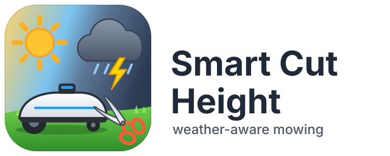

<picture>
  <source media="(prefers-color-scheme: dark)" srcset="custom_components/dreame_smart_cut_height/brand/dark_logo.png">
  
</picture>

# Dreame Smart Cut Height

A Home Assistant integration that sets a Dreame robot mower's cutting height per zone
from the weather, tuned for the dry tropics (it was built in Townsville): lower after
heavy wet-season rain, a little higher through the dry season, higher again in heat,
dry spells and heatwaves. It asks you on your phone first, then does it itself. Mowing
times stay in the Dreame app.

Based on [edbyford/ha-navimow-weather-cut-height](https://github.com/edbyford/ha-navimow-weather-cut-height),
rewritten for a Dreame A1 and a warm-season lawn. The temperate seasonal rules (autumn
raise, winter pause) are replaced by the tropical wet and dry seasons, and the rules are
per zone. Notes and sources: [`docs/tropical-cut-height-notes.md`](docs/tropical-cut-height-notes.md).

It started as a YAML package with Jinja macros; that version is kept in
[`legacy/`](legacy/) for reference and is no longer maintained.

## How it decides

Zones are opt-in. Each zone in the Dreame app gets its own smart control switch and
usual height. Only switched-on zones are read or changed; a zone that is off is never
touched. On my mower only the Raised Lawn (3.5 cm) is on.

The weather picks an offset, which is added to the usual height of every managed zone:

| Condition | Default rule | Offset | Raised Lawn |
| --- | --- | --- | --- |
| Normal (wet season) | October to April with none of the below | 0 | 3.5 cm |
| After heavy rain | wet season only: 25 mm in 3 days (or 24 h at your gauge) with a 7-day mean of 23 °C or more; held 5 days | -0.5 | 3.0 cm |
| Dry season | May to September with none of the rules below | +0.5 | 4.0 cm |
| Heat | forecast max 34 °C or more today or in the next 2 days; held 3 days | +0.5 | 4.0 cm |
| Dry spell | Smart Irrigation water balance -15 mm or lower, until it is back to 0 | +0.5 | 4.0 cm |
| Heatwave | a heatwave warning for your area, or a 3-day mean of (max + min) / 2 at 29.5 °C or more; held 3 days | +1.0 | 4.5 cm |

- Seasons are the Bureau of Meteorology's for northern Australia: wet 1 October to
  30 April, dry 1 May to 30 September. They are fixed in `plan.py`; south of the tropics
  the rules will need changing.
- Heatwave beats heat or dry spell, which beat heavy rain, which beats the dry season.
- Raise at once, lower slowly: one 0.5 cm step at most every 2 days.
- Targets stay on the A1's 3.0 to 7.0 cm range, in 0.5 cm steps.
- Every threshold and offset is a number entity you can change from a dashboard.

## Ask, then apply

- An hour before each scheduled mow (from the mower's schedule calendar), the plan's
  memory is saved and each managed zone's height is read from the mower. Any change gets
  one phone notification saying what will change and when, with a Skip 2 days button.
- The change is written 5 minutes before the mow if the mower is docked, otherwise once
  it has been docked for 2 minutes. Nothing needs your input; Skip is the only way to
  stop it.
- Before writing, the height is read again; if someone changed it in the app since the
  check, that zone is left alone. The height is read back 2 minutes after the write,
  and you're told if it didn't take.

Heights are written with the Dreame integration's
`dreame_lawn_mower.plan_zone_mowing_preference_update` action, with an explicit zone
id, so only the height for that zone changes. Reading a zone's height means pointing
Home Assistant's map and zone selectors at it; those selectors are local to Home
Assistant and change nothing on the mower. They are put back afterwards.

Two switches keep it safe while you try it:

- `switch.smart_cut_height` (master): off, nothing runs before a mow and the Skip button
  is ignored. Check now still works.
- `switch.smart_cut_height_write_to_mower`: off, nothing is ever sent to the mower.
  Checks still run and notify you, marked "Preview only".

Both start off.

## Weather

All sources are chosen in the integration's settings and can be changed at any time
(Settings > Devices & services > Dreame Smart Cut Height > Configure > Weather sources).
Only the location is required.

- [Open-Meteo](https://open-meteo.com/) (free, no key) for the lawn's latitude and
  longitude: the past 21 days and the next 5, including evapotranspiration. It fills any
  day another source is missing.
- A forecast weather entity, for example the Bureau of Meteorology integration's: its
  daily max and min replace Open-Meteo's for today and the days ahead. On the day I set
  this up BOM had 31 °C for the next few days where Open-Meteo had 29.6 to 30.5 °C.
- A weather station's temperature and rain-total sensors: past days take the daily max,
  min and mean temperature and the day's rain from Home Assistant's long-term
  statistics. The rain sensor needs to be an increasing total (yearly or event rain)
  with statistics. Over three weeks in November my Ecowitt agreed with Open-Meteo on
  temperature to within about 0.5 °C most days, but measured 10.6 mm on the wettest day
  where Open-Meteo had 20.1 mm. Rain is what drives the drop, so local measurement
  matters.
- A rain-in-the-last-24-hours sensor, so a local downpour the model missed still counts
  as heavy rain.
- A Smart Irrigation water balance (bucket) for the lawn. Unlike a plain ET-minus-rain
  deficit it knows about the watering, so a dry spell means the irrigation is falling
  behind (for example under council restrictions). Without it the dry spell comes from
  Open-Meteo's 21-day ET0 minus rain.
- A warnings sensor (the BOM integration has one): a heatwave warning in its state or
  `warnings` attribute counts as a heatwave.

## Install

1. Install [EvotecIT/homeassistant-dreamelawnmower](https://github.com/EvotecIT/homeassistant-dreamelawnmower)
   and, in the Dreame app, set the map's mowing preferences to Custom (per zone), not
   Global.
2. Use the Marketplace button at the top of this page (Home Assistant 2026.11 or newer;
   it opens HACS on older versions), install Dreame Smart Cut Height and restart Home
   Assistant. Or in Settings > Marketplace > Add from link, enter
   `dmacwalter/HA-Dreame-Weather-Dependant-Cut-Height` with type Integration. Without
   either, copy `custom_components/dreame_smart_cut_height` into
   `/config/custom_components/` and restart.
3. Use the second button, or Settings > Devices & services > Add integration > Dreame
   Smart Cut Height. Pick the mower; the docked sensor, schedule calendar, map and zone
   selectors and zone height are looked up on the mower's device for you to check. Then
   the map whose zones you manage, then the weather sources.
4. On the new Smart cut height device, switch on the zones you want managed and set
   their usual heights.
5. Turn on the master switch and watch a few "Preview only" notifications.
6. Turn on Write to mower. After the first change, check the app shows the new height
   for that zone.

Zones come from the Dreame zone selector's options ("Raised Lawn (#1)" or "Zone #3").
Zones added or renamed in the app later are picked up when you save the Mower entities
page of the settings.

## Entities

On the Smart cut height device (`<zone>` is the zone's name, for example `raised_lawn`):

- `switch.smart_cut_height`, `switch.smart_cut_height_write_to_mower`,
  `switch.smart_cut_height_<zone>_smart_control`
- `number.smart_cut_height_<zone>_usual_height`, the four offsets (after heavy rain,
  heat or dry spell, heatwave, dry season) and the six thresholds
- `sensor.smart_cut_height_weather_plan` (the condition; attributes include the target
  heights, the holds and how many station and forecast days were used),
  `sensor.smart_cut_height_next_change`, `sensor.smart_cut_height_managed_zones`,
  `sensor.smart_cut_height_<zone>_target_height`, the offset, 3-day rain, 7-day mean and
  21-day deficit
- `button.smart_cut_height_check_now` (a preview: reads the zones and tells you what the
  next mow will change, writes nothing) and `button.smart_cut_height_skip_2_days`
- Actions `dreame_smart_cut_height.check` and `.skip`

`dashboards/cut_height_view.yaml` is a dashboard view with all of it on one screen, and
`dashboards/cut_height_card.yaml` is the Dreame
[lawn-mower-card](https://github.com/EvotecIT/lovelace-lawn-mower-card) with zone
choice and the main settings added.

## Scheduling: leave it in the Dreame app

The Dreame app keeps the schedule, and Home Assistant follows it through the calendar.
The mower still mows on time if Home Assistant is down, and you can change the schedule
in the app without touching this. Mine ("Before watering": Tuesday, Thursday and
Saturday evenings) lines up with the irrigation in the early hours of the next day, so
the lawn is cut dry, then watered.

## Moving from the YAML package

On its first start the integration copies the package's settings and memory from its
helpers if they exist: thresholds, offsets, usual heights, which zones are on, the
dry-spell latch, the hold dates, the last lowering, a skip and anything pending. After
that it keeps its own copy and the helpers are no longer used.

1. Install and add the integration as above, with both switches off. Compare
   `sensor.smart_cut_height_weather_plan` with `sensor.cut_height_plan` for a few days.
2. Turn off the package's master switch (`switch.cut_height_smart`), then turn on the
   integration's. Its Skip button has a different action name from the package's, so a
   tap only ever reaches one of them.
3. Turn on Write to mower.
4. Remove `packages/dreame_cut_height.yaml` and `custom_templates/cut_height.jinja`,
   restart, and delete the `cut_height_*` helpers if you made them in the UI. Point
   dashboards at the new entities (see `dashboards/`).

## Tests

    python3 -m venv .venv && .venv/bin/pip install -r requirements_test.txt
    .venv/bin/python -m pytest
    python3 tools/replay.py --lat -19.26 --lon 146.82 --start 2024-07-01 --end 2026-06-30

- `tests/test_plan.py`: each weather rule.
- `tests/test_weather_merge.py`: source precedence (including a snapshot from my live
  setup) and zone labels.
- `tests/test_integration.py`: set-up and settings, entity lookup on the mower's device,
  the pre-mow check, the automatic write and read-back, waiting for the dock, the
  stale-height guard and skip, against a fake mower in Home Assistant's test harness.
- `tools/replay.py` replays the rules over past weather, mowing day by mowing day, so
  you can tune the thresholds for your location. It needs only Python.

## Requirements

- Home Assistant 2026.3 or newer for the icon and logo (tested on 2026.2 and running on
  2026.11).
- EvotecIT/homeassistant-dreamelawnmower, built against v0.2.196 on a Dreame A1. It's
  unofficial and uses Dreame's cloud, so it can break if Dreame changes it. Its write
  actions are marked for supervised use, so keep an eye on the read-back messages at
  first.

## Licence

MIT. See `LICENSE`.
